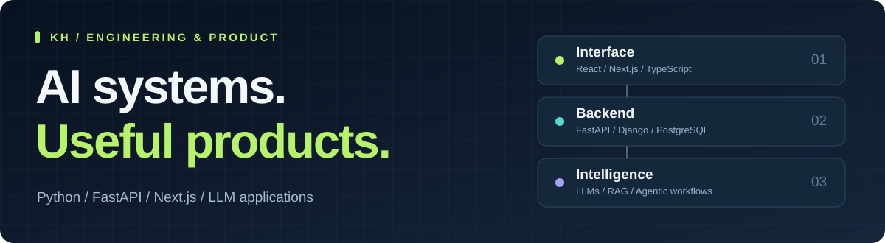

  

<h1 align="center">Khawaja Muhammad Laeeq</h1>

<strong>Agentic AI Developer · Full-Stack Developer · Python Backend Developer</strong> Lahore, Pakistan · Building applications from backend to interface

  <a href="https://www.khawajalaeeq.me"><strong>Portfolio ↗</strong></a> &nbsp;&nbsp; / &nbsp;&nbsp;
  <a href="https://www.linkedin.com/in/khawaja-laeeq"><strong>LinkedIn ↗</strong></a> &nbsp;&nbsp; / &nbsp;&nbsp;
  <a href="https://medium.com/@khawajalaeeq2"><strong>Technical writing ↗</strong></a>

<a href="#user-content-selected-projects">Projects</a> · <a href="#user-content-technical-stack">Stack</a> · <a href="#user-content-certifications-and-course-credentials">Certifications</a> · <a href="#user-content-experience-and-education">Experience</a>

<h2>About me</h2>

I'm Khawaja Laeeq, an <strong>agentic AI and full-stack developer in Lahore, Pakistan</strong>. I build LLM applications, Python APIs, and web products using <strong>FastAPI, Django, React, and Next.js</strong>. My work includes retrieval-augmented generation (RAG), AI agents, Model Context Protocol (MCP), and systems that turn information into useful recommendations.

I bring practical experience from <strong>Arbisoft</strong> and <strong>Arch Technologies</strong> into projects spanning scholarship discovery, competitive intelligence, and job-search automation.

<h2 id="selected-projects">Selected projects</h2>

Applications built around a specific problem, with code you can explore.

<table>
<tr>
<td width="50%" valign="top">
<h3>01 &nbsp; GrantPilot</h3>

<strong>AI scholarship discovery &amp; matching</strong>

Matches students with scholarship opportunities using academic profiles and eligibility criteria. Includes opportunity ingestion, filtering, and LLM-assisted discovery.

<code>LLMs</code> <code>Recommendations</code> <code>REST APIs</code>

<a href="https://github.com/KH-M-LAEEQ/GrantPilot"><strong>Explore code →</strong></a> &nbsp; <a href="https://www.grantpilot.works">Visit project ↗</a>

</td>
<td width="50%" valign="top">
<h3>02 &nbsp; Competitive Intelligence</h3>

<strong>Agentic AI for competitor monitoring</strong>

Monitors e-commerce competitor websites, surfaces changes and comparisons, and provides AI-assisted suggestions for a store's next steps.

<code>FastAPI</code> <code>Next.js</code> <code>Web scraping</code>

<a href="https://github.com/KH-M-LAEEQ/Competitive-Intelligence-Monitor"><strong>Explore code →</strong></a> &nbsp; <a href="https://competitive-intelligence-monitor.vercel.app/">Visit project ↗</a>

</td>
</tr>
<tr>
<td width="50%" valign="top">
<h3>03 &nbsp; Khawaja &amp; Associates</h3>

<strong>A web presence for a Lahore law practice</strong>

A website presenting the firm's history, practice areas, team, and publications with an editorial layout.

<code>Next.js</code> <code>Web development</code> <code>UI design</code>

<a href="https://github.com/KH-M-LAEEQ/Khawaja-and-Associates"><strong>Explore code →</strong></a> &nbsp; <a href="https://www.khawajalaw.site">Visit project ↗</a>

</td>
<td width="50%" valign="top">
<h3>04 &nbsp; Fitness App</h3>

<strong>A personal fitness tracker</strong>

A Flutter application backed by Firebase, with a web build available to explore alongside the mobile codebase.

<code>Flutter</code> <code>Dart</code> <code>Firebase</code>

<a href="https://github.com/KH-M-LAEEQ/Fitness-App"><strong>Explore code →</strong></a> &nbsp; <a href="https://fitnessapp-a5ec5.web.app">Visit project ↗</a>

</td>
</tr>
</table>

<strong>In progress — ApplyPilot:</strong> a CV-aware job-discovery and application-tracking system. Current work focuses on evidence-based eligibility checks, vacancy verification, and evaluating recommendation quality.

<h2 id="technical-stack">Technical stack</h2>
<table>
<tr><th align="left">Area</th><th align="left">Tools &amp; concepts</th></tr>
<tr><td><strong>AI engineering</strong></td><td>LLM integration, AI agents, RAG, embeddings, vector databases, MCP</td></tr>
<tr><td><strong>Backend</strong></td><td>Python, FastAPI, Django, REST APIs, PostgreSQL, Firebase</td></tr>
<tr><td><strong>Frontend</strong></td><td>TypeScript, JavaScript, React, Next.js, HTML, CSS</td></tr>
<tr><td><strong>Machine learning</strong></td><td>PyTorch, Scikit-learn, NumPy, Pandas, NLP</td></tr>
<tr><td><strong>Mobile</strong></td><td>Flutter, Dart, Android SDK</td></tr>
<tr><td><strong>Cloud &amp; delivery</strong></td><td>AWS EC2, S3, EKS, DynamoDB, CloudWatch, Docker, Git, GitHub</td></tr>
</table>

<h2 id="certifications-and-course-credentials">Certifications &amp; course credentials</h2>

Continued learning across AI, cloud computing, software development, and engineering fundamentals.

<table>
<tr><th align="left">Credential</th><th align="left">Provider / platform</th><th>Credential link</th></tr>
<tr><td><strong>Introduction to Large Language Models</strong></td><td>Google Cloud · Coursera</td><td><a href="https://coursera.org/verify/ADWRK50YAUHJ">View ↗</a></td></tr>
<tr><td><strong>AWS Academy Graduate — Cloud Foundations</strong></td><td>AWS Academy · Credly</td><td><a href="https://www.credly.com/badges/4a99a823-3467-4a6f-a94f-388c32b50b4b">View ↗</a></td></tr>
<tr><td><strong>Claude Academy Graduate</strong></td><td>Anthropic · Claude Academy</td><td><a href="https://academy.claude.com/badges/fdf918a7-0368-4f07-b971-35528ee2274a">View ↗</a></td></tr>
<tr><td><strong>Version Control</strong></td><td>Meta · Coursera</td><td><a href="https://coursera.org/verify/6RPHSQXJ6URL">View ↗</a></td></tr>
<tr><td><strong>Introduction to Front-End Development</strong></td><td>Meta · Coursera</td><td><a href="https://coursera.org/verify/WD8FLB6ZCH8N">View ↗</a></td></tr>
<tr><td><strong>Introduction to Android Mobile Application Development</strong></td><td>Meta · Coursera</td><td><a href="https://coursera.org/verify/FAFL401899GW">View ↗</a></td></tr>
<tr><td><strong>QuickStart: From Algorithm Design to Working Prototype</strong></td><td>HEC Pakistan · Coursera</td><td><a href="https://coursera.org/verify/ID2HKN39YY7A">View ↗</a></td></tr>
</table>

<h2 id="experience-and-education">Experience &amp; education</h2>

<strong>Arbisoft — Agentic AI Intern</strong> Django and React applications, REST APIs, authentication, testing, LLM integration, and agentic workflows. <a href="https://github.com/KH-M-LAEEQ/Portfolio/blob/main/public/certificates/arbisoft-internship-letter.pdf">Internship letter ↗</a>

<strong>Arch Technologies — ML Intern</strong> Python-based model development, NLP, embeddings, PyTorch, and exposure to RAG pipelines.

<strong>BS Computer Science — University of Central Punjab, Lahore</strong> 2023–2027 · Expected graduation: 2027

<h2>Writing about AI engineering</h2>
<ul>
<li><a href="https://medium.com/@khawajalaeeq2/5-guardrails-i-add-before-any-ai-agent-touches-real-data-1cdc07b32896">5 Guardrails I Add Before Any AI Agent Touches Real Data</a></li>
<li><a href="https://medium.com/@khawajalaeeq2/streaming-agent-responses-to-a-react-next-js-ui-in-real-time-77b782bec8ae">Streaming Agent Responses to a React/Next.js UI in Real Time</a></li>
<li><a href="https://medium.com/@khawajalaeeq2/short-term-vs-long-term-memory-in-ai-agents-a-practical-implementation-327511895227">Short-Term vs Long-Term Memory in AI Agents: A Practical Implementation</a></li>
</ul>

<strong>Have an AI application or web product in mind?</strong> I'm interested in AI engineering, Python backend development, and full-stack collaboration.

<a href="https://www.linkedin.com/in/khawaja-laeeq"><strong>Let's connect on LinkedIn →</strong></a> &nbsp; · &nbsp; <a href="https://www.khawajalaeeq.me">Explore my portfolio ↗</a>

